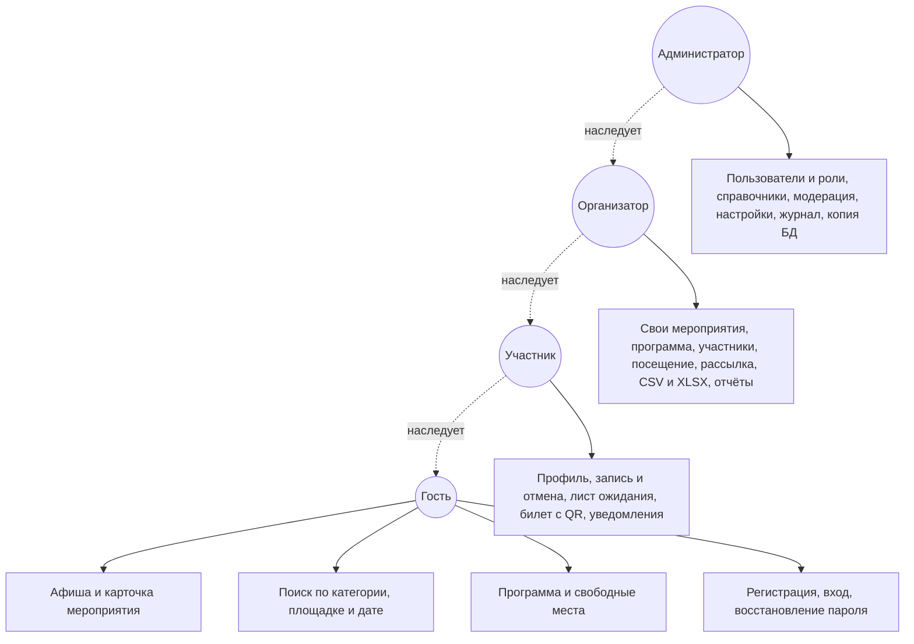

# Prestige Events — платформа для событий и мероприятий

Веб-приложение по техническому заданию «Платформа для событий и мероприятий Prestige Events» (ИМСИТ, Краснодар): афиша, регистрация участников, билеты с QR-токеном, программы мероприятий, лист ожидания, уведомления в кабинете и по электронной почте, роли (гость / участник / организатор / администратор), добавление / изменение / удаление записей всех 11 таблиц через интерфейс, журнал действий, выгрузки CSV и XLSX, резервная копия.

Стек: PHP 8.1+ (серверный рендеринг), JavaScript (проверка форм, меню, Fetch API), CSS, PDO с подготовленными запросами. Фреймворков и внешних библиотек нет: плоская структура файлов, как в обычной студенческой работе.

У приложения два режима базы данных — одна и та же логика и те же 11 таблиц из ТЗ:

| Режим | Когда использовать | Файл схемы |
|---|---|---|
| `sqlite` | Быстрый запуск в VS Code без установки сервера БД, проверка всех функций | `database/sqlite.sql`, база `data/prestige.db` создаётся сама при первом открытии сайта |
| `sqlsrv` | Основной режим по ТЗ: Microsoft SQL Server 2019/2022 | `database/mssql.sql` (ваша схема + начальные данные) |

Режим переключается одной строкой `$dbType` в `includes/config.php`.

### Быстрый старт

```powershell
php -v
php -S localhost:8000
```

Открыть `http://localhost:8000`. База SQLite создастся сама при первом открытии. Подробно, с шагами по установке PHP и VS Code, — Часть A ниже; подключение настоящего SQL Server — Часть B.

## Анализ требований к веб-приложению

### Что система должна делать

По разделам 3.1 и 4.1.1 ТЗ объект — колледж, который проводит собственные бесплатные мероприятия. Значит, в приложении нужны четыре группы функций и ничего лишнего (оплата и возврат средств по ТЗ не реализуются):

| Подсистема | Содержание | Страницы | Таблицы БД |
|---|---|---|---|
| Публичная часть | Афиша, карточка, поиск по категории / площадке / дате, программа и число свободных мест | `index.php`, `event.php` | `events`, `categories`, `venues`, `event_program` |
| Учётные записи | Регистрация, вход по логину и паролю, восстановление пароля, профиль без смены роли | `login.php`, `register.php`, `cabinet.php`, `logout.php` | `users`, `roles` |
| Участие | Запись и отмена, лист ожидания с автопродвижением, билет с QR-токеном, уведомления | `event.php`, `cabinet.php` | `registrations`, `waitlist`, `notifications` |
| Организатор | Свои мероприятия и программа, список участников, отметка посещения по токену, рассылка, CSV / XLSX, отчёты | `organizer.php`, `event_edit.php`, `participants.php`, `export.php` | `events`, `event_program`, `registrations` |
| Администратор | Пользователи и роли, справочники, модерация любых мероприятий, настройки, журнал, резервная копия | `admin.php`, `users.php`, `categories.php`, `venues.php`, `backup.php` | все 11 таблиц |

### Диаграмма вариантов использования (п. 4.1.1 ТЗ)

Старшие роли наследуют возможности младших:



Гость — это неавторизованный посетитель: учётной записи у него нет, но код `guest` хранится в справочнике `roles` для полноты модели. Роль любого вошедшего пользователя читается из БД (`users.role_id → roles.code`) при каждом запросе, проверяется на сервере функцией `requireRole()` и дополнительно проверкой владельца мероприятия `canEditEvent()`. Поле «роль» есть только в форме администратора; в профиле и при регистрации его нет, поэтому пользователь не может повысить себе права, даже отправив `role_id` вручную.

### Входные и выходные данные (п. 4.1.2 ТЗ)

| Поток | Реализация |
|---|---|
| Ввод | HTML-формы (`POST`) и асинхронные запросы `fetch()` к `api.php`; проверка на клиенте (`assets/app.js`) и обязательно на сервере (PHP) |
| Хранение | Только подготовленные PDO-запросы; пароли — `password_hash`, вывод — `htmlspecialchars`, формы — CSRF-токен |
| Вывод на экран | SSR-страницы в браузере, уведомления в кабинете, счётчик непрочитанных обновляется раз в 5 секунд |
| Выгрузки | Списки участников CSV и XLSX, сводные отчёты CSV и XLSX (`export.php`) |
| Почта | Письма ставятся в очередь `notifications` с `channel = 'email'`; администратор отправляет их через `mail()` или отмечает отправленными |

### Противоречия и неоднозначности ТЗ

Их полезно назвать на защите самому, до вопросов преподавателя:

| Место в ТЗ | Несоответствие | Как решено в проекте |
|---|---|---|
| Заголовок скрипта БД «SQL Server 2016+» и коллация `Cyrillic_General_100_CI_AI_SC_UTF8` | UTF-8-коллации появились только в SQL Server 2019, на 2016 скрипт упадёт | Основной режим — SQL Server 2019/2022, как и написано в п. 4.5 ТЗ |
| П. 4.5: «СУБД Microsoft SQL Server 2019/2022 8.0» | 8.0 — это версия ODBC-драйвера, а не СУБД | В документации указаны SQL Server 2019/2022 + ODBC Driver 18 + `pdo_sqlsrv` |
| П. 7: «разработка проводится в три стадии», таблица 1 содержит пять стадий | Опечатка в тексте | Работа описана по таблице 1: ТЗ → эскизный → технический → рабочая документация → внедрение |
| П. 4.1.1: гость назван ролью и одновременно «неавторизованным посетителем» | Роль без учётной записи | Гость = отсутствие сессии; код в `roles` оставлен справочно |
| П. 4.1.2: БД — SQL Server, но стенд должен запускаться в VS Code | Установка SQL Server на каждый ПК тяжела | Два режима с одинаковой схемой из 11 таблиц: `sqlite` для разработки, `sqlsrv` для сдачи; переключение одной строкой |
| П. 3.1 и 4.1.2: уведомления по электронной почте | В колледже нет почтового сервера / SMTP | Очередь писем в таблице `notifications`, попытка отправки `mail()` из админки, честный статус `pending` / `failed` / `sent` |
| П. 4.1.2: выгрузки XLSX | Часто подменяют HTML-таблицей с расширением `.xls` | Настоящий XLSX (ZIP + XML) собирается своим кодом без библиотек и расширения `zip` |
| П. 4.5: «JavaScript (Fetch API)» | Формы сами по себе асинхронными не являются | `api.php` + `fetch()` в `app.js`: счётчик уведомлений и обновление свободных мест |
| П. 4.1.3: время реакции ≤ 3 с, актуализация ≤ 5 с | Требует обоснования | Серверный рендеринг без тяжёлых отчётов в запросе, индексы из скрипта БД, опрос счётчика каждые 5 секунд |
| П. 4.5: HTTPS, защита от SQL-инъекций / XSS / CSRF, 152-ФЗ | Требуется на эксплуатации | Подготовленные запросы, экранирование, CSRF, согласие при регистрации; HTTPS настраивается при развёртывании (Часть B) |
| П. 5: восемь документов по ГОСТ 19.101-77 | Документы обычно оформляются отдельно на А4 | Содержание закрыто этим README и комментариями к структуре; перечень — в разделе «Программная документация» ниже |

### Требования к программной документации (п. 5 ТЗ)

| Документ по ГОСТ | Где отражён в проекте |
|---|---|
| Техническое задание (19.201-78) | Исходное ТЗ заказчика, требования сведены в раздел «Анализ требований» |
| Спецификация (19.202-78) | `database/mssql.sql`, `database/sqlite.sql` и таблица «Структура проекта» |
| Текст программы (19.401-78) | Все `.php`, `.js`, `.css` в репозитории |
| Описание программы (19.402-78) | README: разделы «Вход», «Структура проекта», «Как таблицы меняются через интерфейс» |
| Пояснительная записка (19.404-79) | Разделы «Анализ требований» и «Соответствие техническому заданию» |
| Руководство программиста (19.504-79) | «Структура проекта», «Часть A» и «Часть B» |
| Руководство оператора (19.505-79) | Контрольный список в шаге 6 и раздел «Типовые ошибки» |
| Формуляр (19.501-78) | Сведения о версии PHP, СУБД и составе дистрибутива в Части A и Части B |

## Вход: учётные записи из базы данных

Роль записана в БД (`users.role_id → roles`) и при регистрации не выбирается: новая учётная запись всегда `participant`. Сменить роль может только администратор в «Админ → Пользователи».

| Логин в форме входа | Полный email | Пароль | Роль | Куда ведёт после входа |
|---|---|---|---|---|
| `admin` | `admin@prestige.local` | `1234` | Администратор | `admin.php` |
| `organizer` | `organizer@prestige.local` | `5678` | Организатор | `organizer.php` |
| `student` | `student@prestige.local` | `1111` | Участник | `cabinet.php` |

Без входа работает роль «Гость»: афиша, поиск по названию/категории/площадке/дате, карточки и программы мероприятий.

В базе уже есть демонстрационные данные: 4 опубликованных мероприятия, 1 завершённое, 1 на модерации, программы, записи участника `student`. На «Олимпиаде по программированию» специально стоит вместимость `1`, и место занято — на ней удобно показывать лист ожидания: зайдите новым участником, нажмите «В лист ожидания», затем войдите как `student` и отмените его запись — ожидающий получит билет и уведомление автоматически.

---

## Часть A. Запуск в VS Code (Windows), быстрый режим SQLite

### Шаг 1. Установить VS Code и Git

1. Установить [Visual Studio Code](https://code.visualstudio.com/).
2. Установить [Git for Windows](https://git-scm.com/download/win) (нужен, чтобы склонировать репозиторий; если проект уже скачан архивом с GitHub — Git можно пропустить, просто распакуйте архив).

### Шаг 2. Установить PHP 8.2

1. Открыть https://windows.php.net/download/ и скачать ZIP версии PHP 8.2 (или новее) **VS17 x64 Thread Safe**.
2. Распаковать архив в папку `C:\php` (чтобы файл `php.exe` лежал прямо в `C:\php\php.exe`).
3. Добавить `C:\php` в PATH:
   Пуск → «Изменение системных переменных среды» → «Переменные среды» → в верхнем списке выбрать `Path` → «Изменить» → «Создать» → вписать `C:\php` → везде «OK».
4. Полностью закрыть и снова открыть VS Code и все окна терминала (PATH читается при запуске).
5. В терминале VS Code (`Ctrl + \``) проверить:

```powershell
php -v
```

Должна напечататься версия, например `PHP 8.2.x`. Если пишет «не является командой» — PATH не подхватился: перепроверьте шаг 3 и перезапуск VS Code (раздел «Типовые ошибки» ниже).

### Шаг 3. Включить расширения SQLite в php.ini

Без этого будет ошибка «could not find driver».

1. В папке `C:\php` сделать копию файла `php.ini-development` и назвать копию `php.ini`.
2. Открыть `C:\php\php.ini` в VS Code.
3. Через поиск (`Ctrl+F`) найти и раскомментировать строки (убрать `;` в начале строки), чтобы получилось так:

```ini
extension_dir = "ext"
extension=mbstring
extension=pdo_sqlite
extension=sqlite3
```

4. Сохранить файл (`Ctrl+S`).
5. Проверить в терминале:

```powershell
php -m | findstr sqlite
```

Должны появиться строки `pdo_sqlite` и `sqlite3`.

Другие расширения для работы не нужны: XLSX-файлы собираются средствами самого PHP (ZIP и XML в коде), а асинхронные запросы и проверка форм — обычный JavaScript. Отправка писем через `mail()` работает только при настроенном SMTP в `php.ini`; без него письма остаются в очереди в базе и их можно отметить отправленными вручную.

### Шаг 4. Получить проект и открыть в VS Code

Вариант через Git:

```powershell
cd $HOME\Documents
git clone https://github.com/morikifa/prestige-events.git
cd prestige-events
code .
```

Или вручную: на GitHub кнопка `Code → Download ZIP` → распаковать → в VS Code `Файл → Открыть папку…` → выбрать папку проекта.

По желанию поставить расширения VS Code (не обязательны для работы): `PHP Intelephense` (подсказки PHP), `SQLite Viewer` (просмотр файла базы прямо в редакторе).

### Шаг 5. Запустить сайт

В терминале VS Code (**Терминал → Создать терминал**, терминал должен находиться в папке проекта):

```powershell
php -S localhost:8000
```

Открыть в браузере: http://localhost:8000

При первом открытии рядом с проектом сама создастся папка `data` с файлом `prestige.db`: код в `includes/db.php` видит, что таблиц нет, и выполняет `database/sqlite.sql` (11 таблиц, индексы, роли, категории, площадки, настройки, три учётные записи, мероприятия, программы, записи и уведомления). Устанавливать SQL Server на этом этапе не нужно.

Остановка сервера — `Ctrl+C` в том же терминале. Когда меняете PHP/CSS — просто обновляйте страницу браузера, сервер перезапускать не надо (кроме случаев, когда меняете `php.ini`).

Сбросить базу к исходному демо-состоянию: остановить сервер → удалить файл `data\prestige.db` → запустить сервер → открыть сайт (база создастся заново из `database/sqlite.sql`).

Посмотреть содержимое базы: кликнуть `data\prestige.db` при установленном расширении SQLite Viewer, либо скачать бесплатный DB Browser for SQLite и открыть в нём файл.

### Шаг 6. Проверить все роли по порядку (контрольный список)

1. **Гость** (без входа): на главной есть 4 мероприятия; фильтр «Поиск по названию» со словом `SQL` оставляет одно; открыть конференцию — видна программа из 3 пунктов и число свободных мест.
2. **Гость не видит черновики:** прямое открытие мероприятия на модерации (`event.php?id=6`) показывает «Не опубликовано».
3. **Вход:** `student / 1111` → личный кабинет: 3 записи, у активных — QR-картинка и токен; внизу есть непрочитанное уведомление.
4. **Запись:** афиша → «Практический семинар по SQL Server» → «Записаться» → в кабинете появилась запись с токеном, в уведомлениях — «Запись подтверждена».
5. **Лист ожидания:** зарегистрировать через форму регистрации второго участника → записаться на «Олимпиаду по программированию» (мест нет) → статус «Лист ожидания». Затем `student` отменяет свою запись на олимпиаду → у второго участника в кабинете появляется билет и уведомление «Освободилось место».
6. **Выход, вход `organizer / 5678`:** раздел «Организатор» — все его мероприятия. Кнопка «Новое мероприятие» → заполнить форму (обязательны название, категория, начало, окончание) → после сохранения та же страница откроется на разделе «Программа мероприятия» внизу → добавить 2 пункта внутри времени мероприятия.
7. **Участники и отметка:** «Участники» у семинара SQL → вставить токен из шага 4 → статус становится «Посетил»; ссылка из QR-кода (`participants.php?token=…`) открывает ту же страницу и подставляет токен автоматически.
8. **Выгрузки и сводка:** «Список CSV» и «Список XLSX» скачивают списки участников (XLSX открывается в Excel и LibreOffice); в разделе «Организатор» таблица сразу показывает записано/посетило/ожидание/заполняемость, кнопки «Отчёт XLSX» и «Сводка CSV» выгружают общий отчёт.
9. **Рассылка:** в «Участниках» отправить уведомление — оно появляется в кабинете участника и в очереди писем администратора.
10. **Вход `admin / 1234`:** плитка «Категории» → добавить категорию → она сразу появилась в фильтре афиши и форме мероприятия; удалить её.
11. **Модерация:** в админке внизу «Мастер-класс по веб-дизайну» → «Опубликовать» → мероприятие появилось в афише.
12. **Пользователи и роли:** создать пользователя с ролью «Организатор» → выйти и зайти им → доступен раздел организатора (роль поменял именно администратор, сам пользователь в профиле такого поля не имеет); ниже в «Роли» изменить название роли, добавить свою и удалить её, попробовать удалить системную — не даст.
13. **Настройки:** внизу страницы «Админ» изменить `platform_title` → название в шапке поменялось; формами ниже добавить и удалить свой параметр в таблице `settings`.
14. **Почта:** раздел «Почтовые уведомления» → «Отметить» у письма (статус `sent`) → «Отправить» (без SMTP статус станет `failed`, сайт при этом не падает) → «Удалить».
15. **Журнал:** раздел «Журнал действий» показывает `login`, `event_create`, `checkin`, `email_sent` и т.д. с временем и IP.
16. **Асинхронность:** на карточке мероприятия кнопка «Обновить» подтягивает число свободных мест через `fetch()` без перезагрузки; счётчик непрочитанных уведомлений в шапке обновляется каждые 5 секунд.
17. **Резервная копия:** «Резервная копия» → кнопка создания → в `data\backups` появился файл, его можно скачать; восстановление — там же, загрузкой файла `.db`.

---

## Часть B. Запуск с Microsoft SQL Server (основной режим по ТЗ)

Нужен SQL Server **2019 или 2022**: в схеме используется коллация `Cyrillic_General_100_CI_AI_SC_UTF8`, появившаяся в SQL Server 2019 (на 2016 скрипт создания базы упадёт — поправить заголовок «2016+» в исходной пояснительной документации).

### Шаг 1. Установить SQL Server и SSMS

1. Установить SQL Server 2022 Developer (бесплатная) или Express. При установке выбрать режим проверки подлинности **Mixed Mode** и задать пароль для `sa`.
2. Установить SSMS (SQL Server Management Studio).

### Шаг 2. Создать базу вашим скриптом

1. Открыть SSMS, подключиться к серверу (`localhost` или `.\SQLEXPRESS`).
2. `File → Open → File…` → выбрать `database\mssql.sql` из проекта.
3. Нажать `Execute` (F5). Скрипт сам создаёт базу `prestige_events`, 11 таблиц со связями и ограничениями, индексы, роли, категории, площадки, настройки и три учётные записи (`admin@prestige.local/1234`, `organizer@prestige.local/5678`, `student@prestige.local/1111`; пароли в скрипте — уже как хэши `password_hash`).
4. Проверка: в Object Explorer → `Databases → prestige_events → Tables` — 11 таблиц; запрос `SELECT email FROM dbo.users;` возвращает три строки.

Для приложения удобнее отдельный логин, чем `sa`. В SSMS выполнить (пароль придумайте свой):

```sql
CREATE LOGIN prestige_app WITH PASSWORD = 'PrestigeApp2026!';
USE prestige_events;
CREATE USER prestige_app FOR LOGIN prestige_app;
ALTER ROLE db_owner ADD MEMBER prestige_app;
```

### Шаг 3. Поставить драйвер PHP для SQL Server

PHP из коробки с SQL Server не работает, нужны две вещи:

1. **Microsoft ODBC Driver 18 for SQL Server** — установить с сайта Microsoft (x64).
2. **Microsoft Drivers for PHP for SQL Server** под вашу версию PHP: архив со страницы релизов `microsoft/msphpsql` на GitHub. Файлы вида `php_sqlsrv_82_ts_x64.dll` и `php_pdo_sqlsrv_82_ts_x64.dll` (цифры = версия PHP 8.2, `ts` = Thread Safe, `x64`) скопировать в `C:\php\ext`.
3. В `C:\php\php.ini` добавить две строки:

```ini
extension=php_sqlsrv_82_ts_x64.dll
extension=php_pdo_sqlsrv_82_ts_x64.dll
```

4. Проверка в терминале: `php -m | findstr sqlsrv` — должны быть `sqlsrv` и `pdo_sqlsrv`. Если пусто — не совпала версия DLL с версией PHP (самая частая причина) или не установлен ODBC Driver 18.

### Шаг 4. Переключить приложение на SQL Server

Открыть `includes\config.php` и привести значения к виду:

```php
$dbType = 'sqlsrv';
$dbHost = 'localhost';
$dbName = 'prestige_events';
$dbUser = 'prestige_app';
$dbPass = 'PrestigeApp2026!';
```

Для экземпляра Express `$dbHost` будет `'localhost\SQLEXPRESS'`. Перезапустить сервер (`Ctrl+C`, затем снова `php -S localhost:8000`) и зайти теми же `admin / 1234`. Все страницы работают без изменений кода: запросы написаны через PDO и совместимы с обеими СУБД. Вернуться в демо-режим — вернуть `$dbType = 'sqlite';`.

Резервная копия SQL Server: страница «Резервная копия» в админке выполняет `BACKUP DATABASE` в `C:\Backup\` (создайте папку и дайте права службе SQL Server), либо вручную в SSMS: правый клик по базе → `Tasks → Back Up…`. Восстановление: `Databases → Restore Database…` → выбрать `.bak`.

### Шаг 5. HTTPS и ежедневное копирование (п. 4.2 и 4.5 ТЗ)

1. На сервере академии включить HTTPS на Apache / Nginx (сертификат и перенаправление с HTTP); в VS Code для проверки достаточно `http://localhost:8000`.
2. Ежедневную копию поставить заданием SQL Server Agent (`BACKUP DATABASE`) либо Планировщиком заданий Windows для файла `data\prestige.db`. Копии хранить на отдельном носителе не менее 30 суток; список и скачивание копий есть на странице «Резервная копия» админки.
3. Перед приёмо-сдаточными испытаниями пройти контрольный список из шага 6: функции по ролям, попытка зайти в чужой раздел, подбор пароля, полнота документации.

---

## Структура проекта

| Путь | Что там |
|---|---|
| `index.php` | Главная / афиша, поиск и фильтры |
| `event.php` | Карточка мероприятия, программа, запись / отмена / лист ожидания, билет с QR, обновление свободных мест через `fetch()` |
| `api.php` | Асинхронные ответы JSON: число непрочитанных уведомлений и свободные места по мероприятию |
| `login.php`, `register.php`, `logout.php` | Вход по логину и паролю и запрос восстановления через администратора, регистрация участника, выход |
| `cabinet.php` | Кабинет участника: профиль (CRUD себя в `users`, без смены роли), мои мероприятия и токены, лист ожидания, уведомления, смена пароля |
| `organizer.php`, `event_edit.php`, `participants.php`, `export.php` | Раздел организатора: мероприятия и сводка, форма мероприятия с программой внизу, участники и отметка по токену/QR-ссылке, рассылка, выгрузки |
| `admin.php`, `users.php`, `categories.php`, `venues.php`, `backup.php` | Админка: статистика, модерация, настройки, очередь писем и журнал внизу `admin.php`; пользователи и роли с формами на одной странице; справочники и резервная копия |
| `includes/config.php` | Настройки подключения (режим БД, хост, логин, пароль) |
| `includes/db.php` | Подключение PDO (SQLite или SQL Server), автосоздание SQLite-базы |
| `includes/functions.php` | Сессия, текущий пользователь и проверки ролей, CSRF, журнал, уведомления и очередь писем, свободные места, продвижение листа ожидания, slug, токены, сборка XLSX |
| `includes/header.php`, `includes/footer.php` | Общая шапка (меню по роли, счётчик уведомлений) и подвал |
| `assets/style.css`, `assets/app.js` | Стили и клиентские сценарии: проверка форм, меню, запросы `fetch()` к `api.php` |
| `database/mssql.sql` | Схема и начальные данные для SQL Server (основная по ТЗ) |
| `database/sqlite.sql` | Та же схема в синтаксисе SQLite для быстрого запуска |
| `data/` | Файл SQLite-базы и резервные копии (в Git не коммитится) |

## Как таблицы меняются через интерфейс

| Таблица | Добавить | Изменить | Удалить | Кто |
|---|---|---|---|---|
| `users` | `register.php`, форма внизу `users.php` | форма внизу `users.php` (в т.ч. роль, статус, пароль), `cabinet.php` (свой профиль) | `users.php` | Админ; свой профиль — сам пользователь |
| `events` | `event_edit.php` | `event_edit.php`, статус — `organizer.php` / модерация в `admin.php` | `organizer.php` (каскадно уходят программа и записи) | Организатор — свои, админ — любые |
| `event_program` | нижний раздел `event_edit.php` | нижний раздел `event_edit.php` | нижний раздел `event_edit.php` | Организатор своего мероприятия, админ |
| `registrations` | записью из `event.php` | статус и отметка в `participants.php`, в т.ч. по QR-ссылке с токеном | `participants.php`, отмена из `cabinet.php` / `event.php` | Участник — свою запись, организатор — статусы |
| `waitlist` | автоматически при записи на заполненное мероприятие | автопродвижение при освобождении места | `cabinet.php`, `participants.php`, `event.php` | Участник — свою строку |
| `roles` | форма «Роли» внизу `users.php` | там же (код системной роли защищён) | там же (системные роли защищены) | Админ |
| `categories`, `venues` | одноимённые страницы админки | там же | там же (категория с мероприятиями не удалится — FK) | Админ |
| `settings` | начальные данные из SQL и форма «Добавить параметр» в `admin.php` | раздел настроек в `admin.php` | форма «Удалить параметр» там же | Админ |
| `notifications` | автоматически (запись, ожидание, рассылка, отмена, письма) | `is_read` в кабинете; статус и `sent_at` письма — в «Почтовых уведомлениях» админки | каскадно с пользователем и кнопкой «Удалить» у письма | Система / получатель / админ |
| `action_log` | автоматически при каждом действии | не редактируется | не удаляется из интерфейса; при удалении пользователя `user_id` становится NULL и история сохраняется | Просмотр — админ |

## Соответствие техническому заданию

| Требование ТЗ (раздел 4.1.1) | Реализация |
|---|---|
| Гость: афиша и карточка, поиск по категории/площадке/дате, программа и свободные места, регистрация/вход/восстановление пароля | `index.php`, `event.php`, `register.php`, `login.php` (форма восстановления на той же странице) |
| Участник: профиль, запись и отмена, лист ожидания, свои мероприятия, QR-токен, уведомления | `cabinet.php`, действия в `event.php`, автопродвижение листа ожидания в `functions.php` |
| Организатор: свои мероприятия и программа, участники и отметка посещения, рассылка, выгрузка CSV/XLSX, отчёты по своим мероприятиям | `organizer.php` (сводка в таблице), `event_edit.php` (программа внизу), `participants.php` (в т.ч. QR-ссылка), `export.php` |
| Администратор: пользователи/роли, справочники, модерация любых мероприятий, участники по любым мероприятиям, сводные отчёты, настройки, журнал, резервное копирование | `admin.php` (модерация, настройки, почта, журнал), `users.php` (в т.ч. CRUD ролей), `categories.php`, `venues.php`, `organizer.php` (сводка по всем), `backup.php` |
| Разграничение прав по роли из БД, без самостоятельной смены роли | `requireRole()` на сервере + проверки владельца мероприятия `canEditEvent()`; роль в формах есть только у админа |
| Проверка входных данных на клиенте (JavaScript) и на сервере (PHP), сообщение вместо сохранения | `assets/app.js` (совпадение паролей, даты мероприятия) + проверки в каждой форме на сервере; дубль записи участника исключён проверкой и `UNIQUE(event_id, user_id)` в БД |
| Передача данных асинхронными запросами, актуализация сведений не позднее 5 с (п. 4.5, 4.1.3) | `api.php` + `fetch()` в `assets/app.js`: счётчик уведомлений раз в 5 с и обновление свободных мест по кнопке |
| Выходные данные: страницы, CSV, XLSX, уведомления по электронной почте (п. 4.1.2) | `export.php` (настоящий XLSX без библиотек), очередь `notifications` с `channel = 'email'` и отправка `mail()` из раздела «Почтовые уведомления» |
| Диаграмма вариантов использования с наследованием ролей (п. 4.1.1) | Mermaid-диаграмма и таблица подсистем в разделе «Анализ требований» |
| Восстановление пароля и отказ от платных функций (п. 4.1.1) | Форма на `login.php` создаёт запрос администратору в `notifications`; платёжных модулей нет |
| Подготовленные запросы, хэши паролей, защита от SQL-инъекций, XSS, CSRF | Все запросы — `PDO->prepare()`; `password_hash` / `password_verify`; вывод через `htmlspecialchars` (функция `e()`); скрытое поле и проверка `checkCsrf()` в каждой POST-форме |
| БД не ниже 3НФ, таблицы из ТЗ | 11 таблиц из вашего скрипта без изменения схемы; в MSSQL-скрипт добавлен только индекс `idx_registrations_event_status` и начальные данные |
| Русифицированный адаптивный интерфейс, 152-ФЗ | Адаптивная вёрстка; чекбокс-согласие при регистрации |

Честные ограничения учебного стенда (полезно назвать на защите до того, как спросят):

- Почтового сервера на стенде нет: письма складываются в `notifications` с `channel = 'email'` и статусом `pending`. Кнопка «Отправить» в админке вызывает `mail()` — при настроенном SMTP в `php.ini` письмо уйдёт и получит статус `sent`, иначе будет честный статус `failed`; кнопка «Отметить» фиксирует отправку вручную. Схема таблицы уже готова под настоящий SMTP.
- Картинка QR-кода строится сервисом `api.qrserver.com` и требует интернет. Сам токен, ссылка `participants.php?token=…` и ручной ввод токена работают и без интернета.
- XLSX собирается минимальным набором XML внутри ZIP силами PHP: стилей и формул нет, только таблица значений, зато файл настоящий и открывается Excel / LibreOffice без дополнительных расширений PHP. CSV пишется с UTF-8 BOM и разделителем `;`, чтобы русский Excel открывал его в колонках.
- Соль `qr_token_salt` из вашей таблицы `settings` в коде не используется: токены генерируются через `random_bytes()`, что безопаснее; сама настройка в схеме и данных сохранена как в вашем скрипте.

## Типовые ошибки

| Симптом | Причина и лечение |
|---|---|
| `php` не распознаётся как команда | PHP нет в PATH или VS Code открыт до изменения PATH. Закрыть VS Code полностью и открыть заново; проверить, что в `Path` есть именно папка с `php.exe`. |
| `could not find driver` (SQLite или SQL Server) | Не включено расширение в `php.ini` или DLL не подходит к версии PHP. Проверка: `php -m`. Для SQL Server дополнительно нужен ODBC Driver 18. |
| Страница открывается, но после правок ничего не меняется | Кэш браузера (`Ctrl+F5`) или редактируете не ту папку проекта. Сервер `php -S` перезапускать не надо. |
| `SQLSTATE … Login failed for user` | В `config.php` неверные `$dbUser/$dbPass`, либо SQL Server установлен только с Windows-аутентификацией (нужен Mixed Mode), либо пользователю не дали роль в базе. |
| Подключение к SQL Server висит/не находится | Для Express хост должен быть `localhost\SQLEXPRESS`; проверить, что служба SQL Server запущена (`services.msc`). |
| «Неверный логин или пароль» у `admin / 1234` | Открыта база не в том режиме или база пересоздавалась вручную без начальных данных. Для SQLite: остановить сервер, удалить `data\prestige.db`, открыть сайт. Для SQL Server: повторно выполнить `database\mssql.sql` целиком. |
| Порт 8000 занят | Запустить на другом порту: `php -S localhost:8080` и открывать этот адрес. |
| Не удаляется категория или пользователь-организатор | Это работает защита внешних ключей из схемы: сначала переведите мероприятия в другую категорию / удалите мероприятия организатора. |
| Ошибка «Проверка формы» | Форма открыта давно в старой вкладке и CSRF-токен протух со сменой сессии. Обновить страницу и отправить снова. |
| Письмо получило статус `failed` | На стенде не настроен SMTP: в `php.ini` нужны параметры `SMTP`, `smtp_port` и `sendmail_from` (Windows) или sendmail (Linux). Пока их нет — нажмите «Отметить» в разделе «Почтовые уведомления». |
| XLSX не открывается | Файл скачан не полностью или открыт не тем приложением. Проверьте, что браузер докачал `.xlsx`, и откройте его в Excel / LibreOffice. |
| Не удаляется системная роль | Коды `guest`, `participant`, `organizer`, `admin` завязаны на проверки прав, поэтому удалить или переименовать их код нельзя; можно менять название и описание. |

## Дизайн

Светлая архитектурная тема в 3 цветах (фон `#f3f2ee`, текст `#161616`, серый `#8a877f`), без градиентов и теней. Главная страница повторяет композицию референса: мелкая служебная строка и меню сверху, затем крупные геометрические строки `PRESTIGE` слева и `EVENTS` со сдвигом вправо. Шрифт — системный Helvetica/Arial, без внешних файлов шрифтов, поэтому сайт работает полностью офлайн (кроме картинки QR). Файл `assets/style.css` при доработках не менялся: новые элементы используют уже существующие классы, поэтому стиль остался таким же, как в репозитории-образце.
